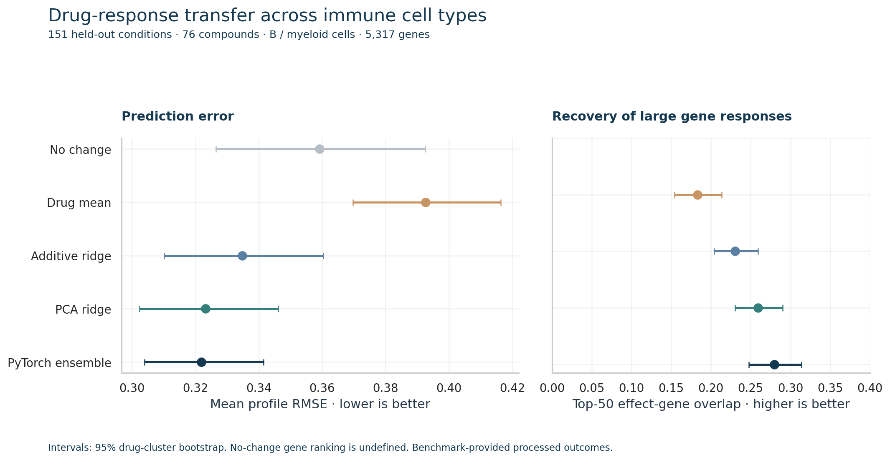

# Predicting drug responses across immune cell types

**Can responses measured in one immune-cell context predict the effect of the same compound in another?**

An exploratory computational-biology study using real public OP3 measurements: five model recipes, a held-out combination test, gene/pathway interpretation, reliability diagnostics, and an offline experiment-selection loop.



## Findings

The PyTorch ensemble reduced mean profile RMSE by **10.4%** versus predicting no change. A linear model with matched response compression performed almost as well: the neural improvement was **0.00131 RMSE**, with a paired 95% drug-cluster interval of **−0.00363 to 0.00689**. This experiment does not establish a clear nonlinear advantage.

| Model | Mean profile RMSE ↓ | Response correlation ↑ | Top-50 effect-gene overlap ↑ |
|---|---:|---:|---:|
| No change | 0.3592 | Undefined | Undefined |
| Transferred drug mean | 0.3926 | 0.247 | 0.183 |
| Additive ridge | 0.3347 | 0.364 | 0.230 |
| PCA ridge | 0.3232 | 0.391 | 0.259 |
| PyTorch ensemble | **0.3219** | **0.404** | **0.280** |

Naive cross-context drug averaging was worse than no change. Ensemble disagreement was a poor error indicator (Spearman ρ ≈ 0.01). In a secondary five-seed acquisition simulation, design-based leverage selection improved validation RMSE modestly over random selection at the examined budgets.

Read the [scientific findings](reports/FINDINGS.md) or download **[REPORT.html](REPORT.html)** for the self-contained illustrated report. The HTML file can be opened locally after downloading; GitHub's file view shows its source.

## Study design

- **Data:** OP3 benchmark-provided log2 fold changes relative to DMSO, across 5,317 supplied genes and four immune-cell types.
- **Fit / select / test:** 306 initial fitting profiles (including eight positive-control compound profiles), 96 validation profiles, and 151 final-test profiles. Refit on all 402 development profiles after selecting configurations.
- **Generalization:** complete drug–cell-type combinations are absent from fitting. Final evaluation covers 76 known compounds in B and myeloid cells. The test is combination transfer, not unseen-drug prediction.
- **Models:** no-change and transferred-drug-mean baselines; additive ridge; PCA ridge; a compact PyTorch network with linear and nonlinear branches, trained with three fixed seeds.
- **Evaluation:** equal-weight mean profile RMSE, response correlation, large-effect gene overlap/sign agreement, and paired compound-cluster bootstrap intervals.
- **Interpretation:** descriptive Reactome release 93 gene-set means, with overlap/coverage metadata. These are not enrichment or pathway-activation tests.
- **Experiment selection:** hidden acquisition-pool labels, fixed public-validation evaluation, shared initial conditions/budgets, random versus label-free ridge leverage. The final test is excluded.

**Scope:** released outcomes aggregate donors and include upstream joint preprocessing. This is evaluation on processed benchmark outcomes, not a prospective raw-data-isolated study. It does not infer mechanistic cell–cell signaling or therapeutic efficacy. See the [data card](DATACARD.md) for the exact boundaries.

## Reproduce

Python 3.11+; the recorded run used Python 3.12 and CPU PyTorch. About 300 MB of source data is downloaded. No API key, paid service, or GPU is required.

```bash
python -m venv .venv
source .venv/bin/activate
python -m pip install --upgrade pip
# CPU-only PyTorch; omit this line if an appropriate torch install exists.
python -m pip install torch==2.5.1 --index-url https://download.pytorch.org/whl/cpu
python -m pip install -e '.[test]'
python scripts/download_data.py
OPENBLAS_NUM_THREADS=1 OMP_NUM_THREADS=1 python scripts/run_study.py
python scripts/make_report.py
python -m pytest -q
```

`requirements-repro.txt` pins the direct package versions used for the recorded run. Results can vary slightly across library versions and numerical backends. The default runner re-executes the documented frozen selection/evaluation procedure; it is not a tool for optimizing against private-test results.

To inspect the saved study without rerunning it, start with `reports/summary.csv`, `reports/paired_intervals.json`, and `reports/selection.json`.

## Repository map

| Location | Contents |
|---|---|
| `src/immune_response/` | Download/validation, five models, evaluation, acquisition, pathway summaries |
| `scripts/` | Download, frozen study execution, figure/report generation |
| `tests/` | Category/split integrity, training-only transforms, metrics, acquisition label isolation |
| `reports/` | Per-condition scores, intervals, selection, environment, acquisition histories, pathway coverage |
| `study_plan.json` | Modeling/evaluation choices recorded before final-test scoring |
| `DATACARD.md`, `REFERENCES.md` | Provenance, attribution, licensing, processing limits |

Original experimental data: Cellarity and OP3 authors. Original project code: MIT license; source data and Reactome have their own terms, detailed in the data card. Prepared with AI assistance; all reported numerical results were computed from the cited public measurements. No employer data were used.
